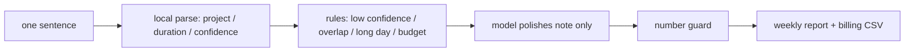

# Hours · time tracking

[](https://github.com/wushiyi105-jpg/hours/actions)

[](./LICENSE)


Log your hours in one sentence and hand the client a bill at month end.

## Features

- Parses a Chinese sentence into project, minutes and note; project names must match the project table.
- Entries with confidence below 0.6 are only suggested, never booked.
- Detects overlapping entries on the same day and project, and long days over 16 hours.
- Two budgets (hours and money) with 80% warnings, plus a client CSV built from the same rate function.

Rules live in `hours/domain/rules/`; the CLI and the web layer only call them. The Chinese README lists every `rule_id` with its penalty.

## Quickstart

```bash
pip install -e ".[dev]"
python -m hours seed
python -m hours report --week 2026-W48
python -m hours log --text "在青禾 SaaS 改版做了 3 小时" --day 2026-11-27
python -m hours bill --week 2026-W48
python -m hours serve        # http://127.0.0.1:8002
```

Run `python -m hours --help` for the full command list; `docker build -t hours . && docker run -p 8002:8002 hours` works the same way.

## Why not just ask a general LLM

A model would turn “a whole morning” into three hours and invent projects you never worked on. Hours resolves durations locally, matches project names against your table, and computes money with one shared function.

## When to use it

- You freelance on several projects and bill each one separately.
- You want to know whether this month’s hours or money crossed the budget.

## Roadmap

- Import history from Toggl or similar timers.
- Export the bill as a PDF with line items.

## FAQ

**What if the sentence is parsed wrong?**
Low-confidence entries are flagged and not booked; fix the wording and log again.

**Do the bill and the report agree?**
Yes, both call the same rate function.

**Was the Docker image verified?**
Docker is not installed on the build machine, so `docker build .` was not run and the image is unverified; only the Dockerfile and ports were checked statically.

## Commands

See the Chinese README (`README.md`) for the command table with flags; every command supports `--help`.

## Dependencies

FastAPI + Uvicorn, Jinja2, pydantic / pydantic-settings, httpx, Typer + Rich, SQLAlchemy + Alembic; dev extras add pytest, pytest-cov, respx, freezegun, ruff, mypy, pip-audit. Version pinning lives in `uv.lock`.

## How it works



## Layout

```
hours/
├── .github/
│   ├── ISSUE_TEMPLATE
│   ├── PULL_REQUEST_TEMPLATE.md
│   └── workflows
├── assets/
│   └── demo.gif
├── data/
│   ├── hours.db
│   └── seed.json
├── hours/
│   └── … 9 项
├── migrations/
│   ├── __init__.py
│   ├── env.py
│   ├── script.py.mako
│   └── versions
├── prompts/
│   └── parse.md
├── templates/
│   └── index.html
├── tests/
│   └── … 9 项
├── CHANGELOG.md
├── CODE_OF_CONDUCT.md
├── CONTRIBUTING.md
├── Dockerfile
├── LICENSE
├── README.en.md
├── README.md
├── SECURITY.md
├── alembic.ini
├── pyproject.toml
```

## Author

Dazhao · GitHub [@wushiyi105-jpg](https://github.com/wushiyi105-jpg) · 17382987315
