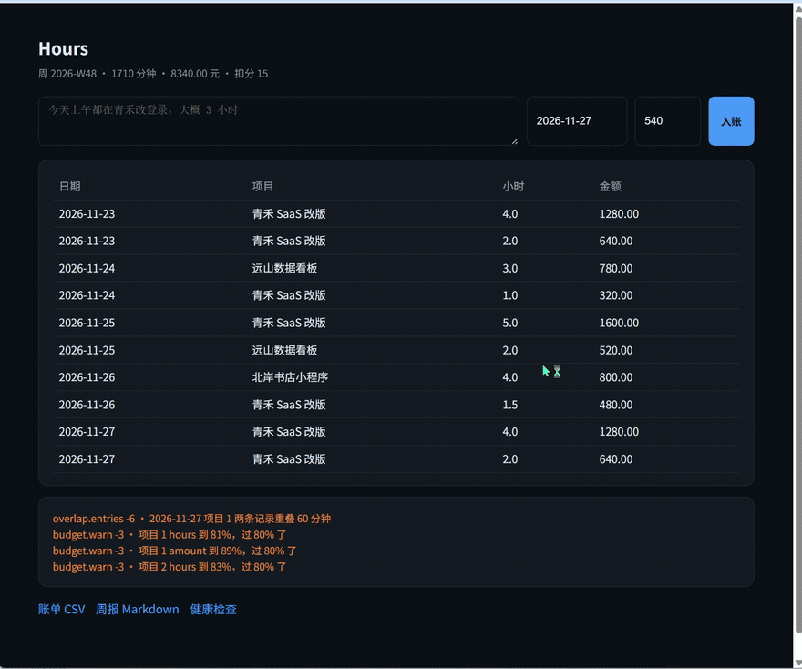

# Hours

[](https://github.com/wushiyi105-jpg/hours/actions)



Log a week of work with one sentence per entry.

## What it does

- parses Chinese duration phrases locally (half day = 240 min);
- rejects unknown projects and low-confidence entries;
- detects overlapping entries on the same project and day;
- tracks hour and amount budgets with 80% / 100% thresholds;
- exports a client bill CSV with the same totals as the report.

## Run

```bash
pip install -e ".[dev]"
python -m hours seed
python -m hours report --week 2026-W48
python -m hours serve
```

## Author

shiyi · GitHub [@wushiyi105-jpg](https://github.com/wushiyi105-jpg) · wushiyi105@gmail.com
