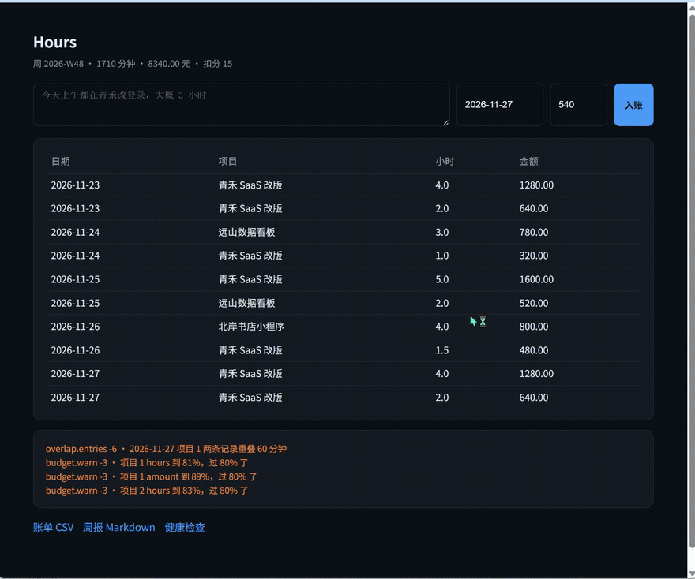

# Hours · 工时

[](https://github.com/wushiyi105-jpg/hours/actions)

[](./LICENSE)



月底填工时，不用再翻聊天记录回忆。

## 为什么不是让模型直接记账

模型会把「一上午」写成 3 小时，也会把没做过的项目编上去。Hours 先把中文时长在本地拆成分钟（半天 240、
一上午 240、两小时 120、45 分钟），项目名必须命中项目表；置信度低于 0.6 的记录只提示、不入账。
金额按项目费率算，和账单 CSV 走同一个函数。

## 它做什么

1. **一句话入账**：口语 → 项目 + 分钟 + 备注。
2. **重叠检测**：同一天同一项目时间相交就报，扣 6 分。
3. **双预算**：工时与金额两条线，80% 预警、100% 超支。
4. **甲方账单**：按费率出 CSV，合计与周报一致。
5. **单日上限**：一天记过 16 小时标出来。

## 怎么用

```bash
pip install -e ".[dev]"
python -m hours seed
python -m hours report --week 2026-W48
python -m hours log --text "在青禾 SaaS 改版做了 3 小时" --day 2026-11-27
python -m hours bill --week 2026-W48
python -m hours serve        # http://127.0.0.1:8002
```

真实种子：3 个项目（费率 320 / 260 / 200）、4 条预算、10 条工时，共 1710 分钟、8340.00 元。
`report --week 2026-W48` 报 4 项：11-27 两条记录重叠 60 分钟；青禾工时 19.5/24（81%）、金额 6240/7000（89%）；
远山工时 5/6（83%）——三条 80% 预警，合计扣 15 分。

## 规则与扣分

| rule_id | 含义 | 扣分 |
| --- | --- | --- |
| `parse.low_confidence` | 拆条置信度 < 0.6，只建议 | 5 |
| `overlap.entries` | 同日同项目时段相交 | 6 |
| `entry.long_day` | 单日 > 16 小时 | 8 |
| `budget.warn` | 预算到 80% | 3 |
| `budget.over` | 预算超 100% | 10 |
| `rate.missing` | 项目没费率，出不了账单 | 10 |

## 边界

- 不接 Toggl / Jira，工时来源是本工具的录入；
- 不做审批与开票，只出 CSV；
- 模型只做备注润色，时长与项目在本地定。

## 作者

shiyi · GitHub [@wushiyi105-jpg](https://github.com/wushiyi105-jpg) · wushiyi105@gmail.com
