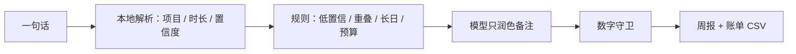

# Hours · 工时

[](https://github.com/wushiyi105-jpg/hours/actions)

[](./LICENSE)


月底填工时，不用再翻聊天记录回忆。


## 功能特性

1. **一句话入账**：口语 → 项目 + 分钟 + 备注。
2. **重叠检测**：同一天同一项目时间相交就报，扣 6 分。
3. **双预算**：工时与金额两条线，80% 预警、100% 超支。
4. **甲方账单**：按费率出 CSV，合计与周报一致。
5. **单日上限**：一天记过 16 小时标出来。

### 规则与扣分

| rule_id | 含义 | 扣分 |
| --- | --- | --- |
| `parse.low_confidence` | 拆条置信度 < 0.6，只建议 | 5 |
| `overlap.entries` | 同日同项目时段相交 | 6 |
| `entry.long_day` | 单日 > 16 小时 | 8 |
| `budget.warn` | 预算到 80% | 3 |
| `budget.over` | 预算超 100% | 10 |
| `rate.missing` | 项目没费率，出不了账单 | 10 |

## 快速开始

```bash
pip install -e ".[dev]"
python -m hours seed
python -m hours report --week 2026-W48
python -m hours log --text "在青禾 SaaS 改版做了 3 小时" --day 2026-11-27
python -m hours bill --week 2026-W48
python -m hours serve        # http://127.0.0.1:8002
```

真实种子：3 个项目（费率 320 / 260 / 200）、4 条预算、10 条工时，共 1710 分钟、8340.00 元。
`report --week 2026-W48` 报 4 项：11-27 两条记录重叠 60 分钟；青禾工时 19.5/24（81%）、金额 6240/7000（89%）；
远山工时 5/6（83%）——三条 80% 预警，合计扣 15 分。

## 为什么不用通用大模型直接问

模型会把「一上午」写成 3 小时，也会把没做过的项目编上去。Hours 先把中文时长在本地拆成分钟（半天 240、
一上午 240、两小时 120、45 分钟），项目名必须命中项目表；置信度低于 0.6 的记录只提示、不入账。
金额按项目费率算，和账单 CSV 走同一个函数。

## 适用场景

- 自由职业者同时接两三个项目，月底要按项目出账单。
- 不想开计时器，只想用一句话把「今天上午在青禾改版」记下来。
- 想知道这个月每个项目的工时和金额有没有越过预算。

### 边界

- 不接 Toggl / Jira，工时来源是本工具的录入；
- 不做审批与开票，只出 CSV；
- 模型只做备注润色，时长与项目在本地定。

## Roadmap

- 接 Toggl / 时钟工具的历史数据导入。
- 账单导出 PDF，带项目明细与合计。
- 客户端只读页面，甲方自己查工时。

## FAQ

**一句话拆错了项目怎么办？**
置信度低于 0.6 的记录只提示、不入账，改完再录。

**账单金额和周报会不一致吗？**
不会，两边走同一个费率函数。

**一天最多能记多少？**
超过 16 小时会被标出来，不拦着记。

**Docker 镜像验证了吗？**
CI 的 `docker` job 每次执行 `docker build .`，启动容器并轮询 `/health`；本机没有 Docker，本地未重复跑。

## 命令参考

| 命令 | 作用 | 常用参数 |
| --- | --- | --- |
| `seed` | 写入 3 个项目、双预算与一周工时。 | --db |
| `log` | 口语入账。 | --text, --day, --start, --db |
| `report` | 看周报与扣分。 | --week, --db |
| `bill` | 出账单 CSV。 | --week, --db |
| `jobs` | 每周汇总提醒。 | --week, --run, --db |
| `doctor` | 四项体检。 | --db |
| `serve` | Web 界面。 | --port, --db |

全部命令都支持 `--help`；只读命令不带参数时读默认库 `data/hours.db`，写命令用 `--db` 指到别的库。

## 依赖说明

| 依赖 | 为什么装 | 不装会怎样 |
| --- | --- | --- |
| `fastapi` + `uvicorn[standard]` | Web 入口与 ASGI 服务 | 只有命令行，没有页面 |
| `jinja2` | 服务端渲染模板 | 页面出不来 |
| `pydantic` + `pydantic-settings` | 配置与数据结构校验，`.env` 直接生效 | 配置散在代码里，改端口要改源码 |
| `httpx` | 调模型与 webhook 的 HTTP 客户端 | 模型层与推送都不可用 |
| `typer` + `rich` | 命令行与终端表格 | 只能用 curl 调接口 |
| `sqlalchemy` + `alembic` | 本地库与迁移 | 表结构变更只能删库重来 |
| `pytest` / `pytest-cov` / `respx` / `freezegun`（dev） | 单测、覆盖率、HTTP 打桩、冻结时间 | 规则改动没有回归保护 |
| `ruff` / `mypy` / `pip-audit`（dev） | 风格、类型、依赖漏洞检查 | CI 只看测试，类型错误会漏进主干 |

装了 `uv` 的话，`uv sync --extra dev` 会按 `uv.lock` 装同一套版本。

## 工作原理




domain 里是时长解析、重叠检测、预算与账单；app 负责周报与 CSV。

## 目录结构

```
hours/
├── .github/
│   ├── ISSUE_TEMPLATE
│   ├── PULL_REQUEST_TEMPLATE.md
│   └── workflows
├── assets/
│   └── demo.gif
├── data/
│   ├── hours.db
│   └── seed.json
├── hours/
│   └── … 9 项
├── migrations/
│   ├── __init__.py
│   ├── env.py
│   ├── script.py.mako
│   └── versions
├── prompts/
│   └── parse.md
├── templates/
│   └── index.html
├── tests/
│   └── … 9 项
├── CHANGELOG.md
├── CODE_OF_CONDUCT.md
├── CONTRIBUTING.md
├── Dockerfile
├── LICENSE
├── README.en.md
├── README.md
├── SECURITY.md
├── alembic.ini
├── pyproject.toml
```

## 质量与供应链

- CI 的 Coverage 步骤带 `--fail-under=70`，覆盖率低于 70% 直接失败。
- `tests/test_app_fake.py` 用真实 `InMemoryStore` 跑主用例，并显式标注 `StorePort` 交给 mypy 做结构校验；测试不创建 SQLite 文件。
- Audit 步骤从 `uv.lock` 导出运行时依赖，再用 `pip-audit -r` 审计；开发工具链不进发布物，运行时依赖有漏洞就让 job 失败，不用 `|| true` 吞错。

## 容器验证

镜像由 CI 的 docker job 构建并探活验证；本机未装 Docker。

## 作者

大钊 · GitHub [@wushiyi105-jpg](https://github.com/wushiyi105-jpg) · 17382987315